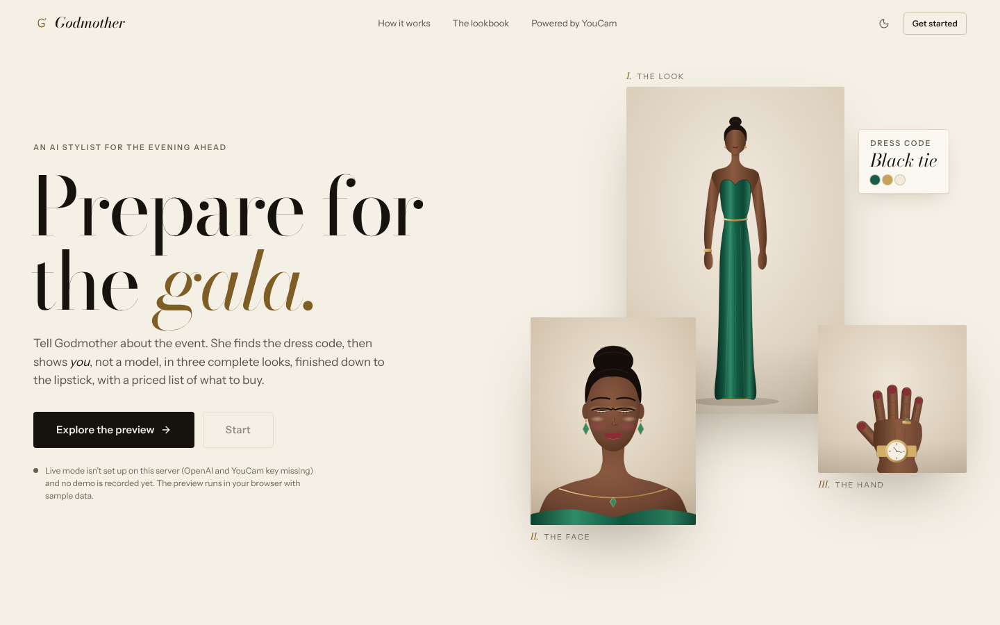
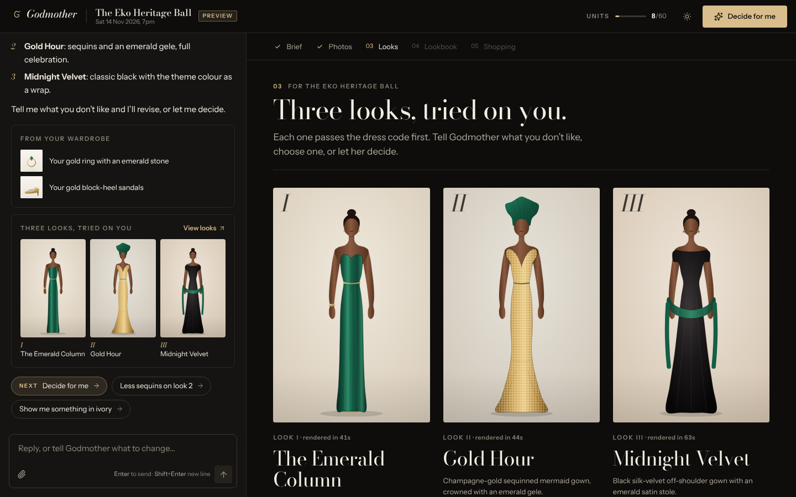
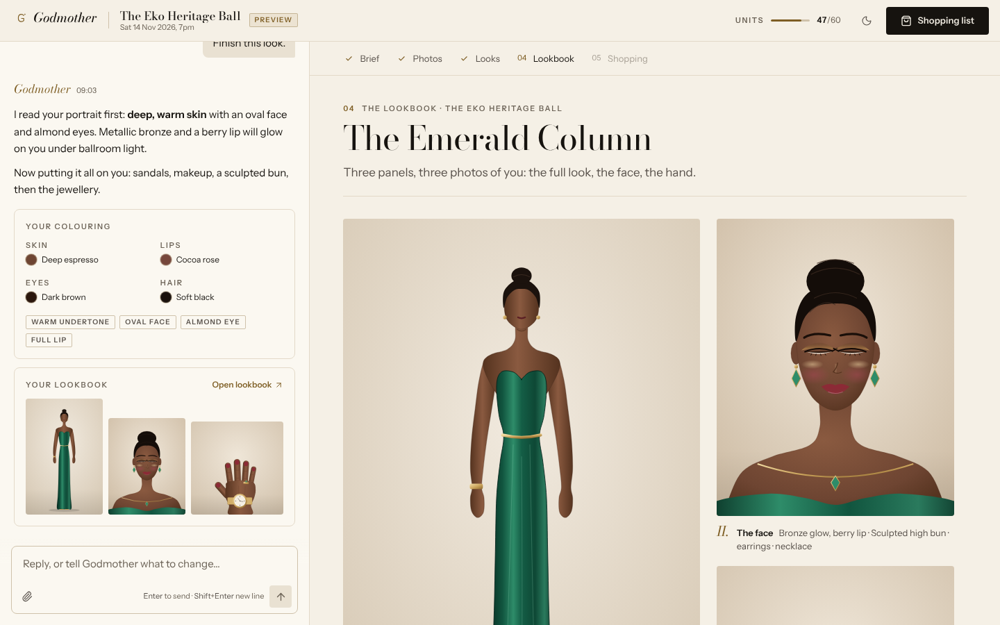
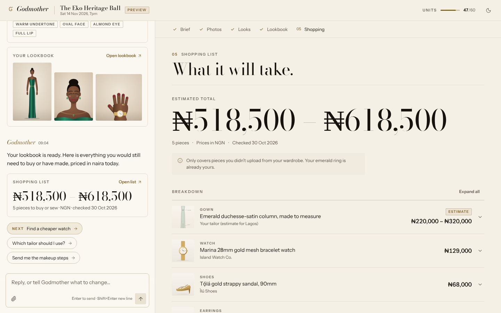
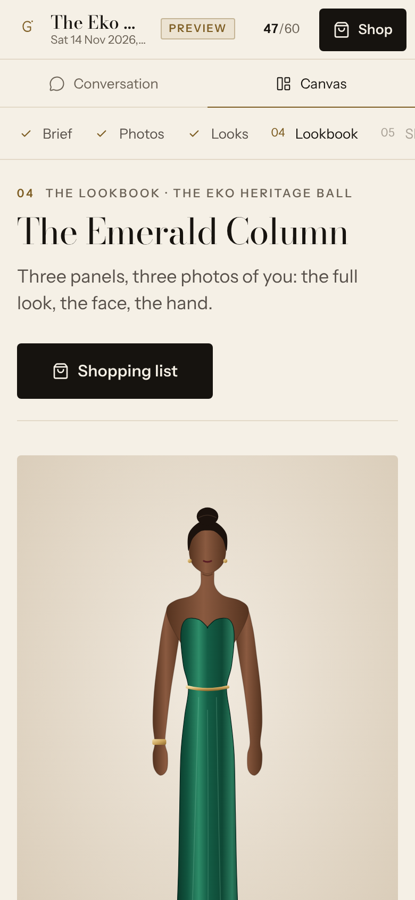

# Godmother

> **Prepare for the gala.**

Godmother is an AI stylist that gets you ready for one specific event. Tell it the event (a name, a link, or a photo of the invitation) and it finds the dress code, colours and setting, then shows **you** in three complete looks: outfit, shoes, makeup, hairstyle and jewellery. Anything you don't already own comes with a priced shopping list.

Virtual try-on, face analysis and the makeup, hair and jewellery renders all run on the [YouCam API](https://yce.perfectcorp.com/ai-api). Built for the **YouCam API Skin AI & eCommerce VTO Hackathon**, eCommerce VTO track.

**Status:** built. Live YouCam and Anthropic runs are still pending; see [Status and honest limits](#status-and-honest-limits).

**Quick links:** [Run it](#run-it) · [YouCam APIs used](#youcam-apis-used) · [Demo mode](#demo-mode) · [Docs](#docs)

## Screenshots

These come from demo mode. The figures are illustrations, not photos of people.











## What it does

1. **Tell it about the event.** Give a name or link (the agent searches the web for the date, venue, dress code, theme and colours), describe it, or upload the invitation (photo or PDF, read by a vision model).
2. **Set where you are.** Location shapes the suggestions (local occasion wear) and the shopping currency.
3. **Add up to three photos.** A full-body photo, a portrait and a hand photo. Optionally, photos of wardrobe pieces you already own, which the agent catalogues.
4. **Get three looks.** Each look is a complete outfit tried on you. Pieces come from your wardrobe, from real shop listings (the actual product photo is what gets tried on), or from a design for a made-to-measure piece.
5. **Decide or revise.** Say what you dislike and only that look is re-rendered. Or say "decide for me" and the agent ranks the three, commits to one and gives its reason.
6. **Finish the chosen look.** Face analysis, then shoes, makeup with DIY steps, hairstyle, earrings, necklace, watch and ring.
7. **Build the shopping list.** Everything you would have to buy or have made, priced in your currency with a total range. Pieces from your wardrobe are left out.

Priority rules: a stated dress code beats everything. Then come event colours and theme, then location and culture, then personal taste.

## YouCam APIs used

All calls are made from the server with a Bearer key (base URL `https://yce-api-01.makeupar.com`). Units are the live price list (docs/API-NOTES.md §1.7). A unit is charged only when a task succeeds.

| API | Endpoint | Called when | Units |
|---|---|---|---|
| File API | `POST /s2s/v2.0/file`, then PUT to the returned storage URL | Before any task. Each input image is uploaded once and its file id reused for up to 29 days | not in the price list |
| Clothes try-on (cloth-v4) | `POST /s2s/v2.0/task/cloth-v4` | Outfit on the full-body photo, one garment per call (`upper_body`, `lower_body`, `full_body`, outer). Runs for all three looks | 2 per garment |
| Shoes | `POST /s2s/v2.0/task/cloth-v4` with `garment_category: "shoes"` | Chosen look only | 2 |
| Facial colour tones | `POST /s2s/v2.0/task/skin-tone-analysis` | Skin tone, undertone and colouring for makeup. Once per session | 20 |
| Face attributes and ratio | `POST /s2s/v2.0/task/face-attr-analysis` | Face shape, eye shape, eyelid, lip shape, eyebrow shape. Once per session | 10 (1 to 5 features) |
| Makeup try-on | `POST /s2s/v2.0/task/makeup-vto` | Chosen look only, from a validated makeup plan, with skin smoothing added by default | 1 |
| Hairstyle V2.1 | `POST /s2s/v2.1/task/hair-transfer`; templates `GET /s2s/v2.1/task/template/hair-transfer` | Chosen look only, template picked by the agent. The template list is free and cached for 6 h | 2 (templates free) |
| Jewellery 2D VTO | `POST /s2s/v2.0/task/2d-vto/{earring,necklace,ring,bracelet,watch}` | Earrings and necklace on the portrait; ring, bracelet and watch on the hand photo. Chosen look only, one item per call | 1 each |
| Image Generator V2 | `POST /s2s/v2.0/task/text-to-image/youcam` | The "sew" path (`design_garment`): an image of a made-to-measure piece | 1 |

A full run (face analysis, three outfits, then finishing with shoes, makeup, hair, earrings, necklace, watch and ring) is 45 units. The default per-session cap is 60.

## Why it's built this way

Unit costs are the main constraint, so the server enforces these rules:

- **Outfits only for all three looks.** Three outfits cost 3 × 2 = 6 units. Shoes, makeup, hair and jewellery (9 units) are rendered only for the look the user chooses.
- **Face analysis once per session.** It is the most expensive step (30 units), so its result is saved on the session and repeat calls return it free.
- **Per-session unit cap.** `UNIT_CAP_PER_SESSION` (default 60). Every task reserves its units synchronously before any network call, so parallel looks cannot overshoot, and a task that would exceed the cap is refused.
- **Validate before paying.** The makeup plan is checked against a whitelist of YouCam pattern labels and palette counts. An invalid plan is rejected before any unit is reserved.
- **One limiter for every YouCam call.** A token bucket (0.8 requests/s, burst 10) sits in front of all task, poll and file calls, under the account limit of 250 requests per 300 s.
- **Never retry a task create.** A create that timed out may already be running, and it is charged on success. A task still running at the poll timeout is counted against the cap.
- **Download results at once.** YouCam result URLs expire after 2 hours, so every result is copied into the asset store immediately.
- **Derived inputs per feature.** Each API gets its own JPEG derived from the stored photo (for example, the skin-tone crop has the face filling most of the frame), so one photo does not have to suit every endpoint.

**Why three photos.** Each YouCam API frames the body differently:

| Photo | Feeds | Why this photo |
|---|---|---|
| Full body, front-facing | Outfit, shoes | Clothes and shoes need the body and feet in frame |
| Portrait | Makeup, hair, earrings, necklace | Makeup needs a face at least 100 px wide; the necklace needs the neck at least 15% of the image width |
| Hand (back of wrist, five fingers visible) | Watch, ring, bracelet | Required by the jewellery API |

Whether a face crop from the full-body photo is good enough for makeup (which would cut the set to two photos) is an open capability question.

## Architecture

```
Browser (SvelteKit pages, streamed turns)
  -> Node server (SvelteKit, adapter-node)
       agent/    15 tools, one turn loop, on a provider-neutral model layer (llm/)
       youcam/   file upload, tasks and polling, unit ledger and cap, rate limiter
       store/    sessions and assets on disk (DATA_DIR)
       demo/     replays a recorded session, no keys, no units
  -> Anthropic API  agent reasoning, web search, vision
  -> YouCam API     the endpoints above
```

The browser never talks to Anthropic or YouCam; keys stay on the server. The agent's 15 tools: `research_event`, `save_event_brief`, `set_location`, `request_photos`, `catalog_wardrobe`, `search_products`, `design_garment`, `propose_looks`, `revise_look`, `decide`, `analyze_face`, `list_hairstyles`, `finish_look`, `build_shopping_list`, `suggest_replies`.

Details: [docs/ARCHITECTURE.md](docs/ARCHITECTURE.md).

## Run it

Requirements: Node.js 22.17 or newer, and pnpm.

```bash
cd app
pnpm install
pnpm dev
```

Open the URL Vite prints (usually http://localhost:5173) and choose **Explore the preview**. Demo mode needs no keys.

**Live mode.** Add your keys and restart:

```bash
cp .env.example .env     # then set ANTHROPIC_API_KEY and YOUCAM_API_KEY
pnpm dev
```

With both keys set, the landing page's Start button is enabled. `.env.example` lists every variable, and `app/README.md` has the table.

**Production.**

```bash
cd app
pnpm build
pnpm start              # reads app/.env, serves on PORT (default 3000)
```

- `BODY_SIZE_LIMIT=12M` (in `.env.example`) lifts adapter-node's 512 KB request limit so 10 MB photos upload.
- Behind a TLS proxy, set `PROTOCOL_HEADER=x-forwarded-proto` and `HOST_HEADER=x-forwarded-host`. adapter-node assumes HTTPS and Origin-checks uploads, so without these, photo uploads are refused.
- Plain HTTP, or a non-default origin: `TRUSTED_ORIGINS` is read at build time (default `http://localhost:3000,http://localhost:4173`), so set it before `pnpm build`, for example `TRUSTED_ORIGINS=https://gala.example.com pnpm build`.

## Demo mode

Demo sessions never call Anthropic or YouCam and spend no units. Each turn replays the next recorded turn of [`app/demo/script.json`](app/demo/script.json), with its original timing (pauses capped at 4 s). Anyone can run the whole flow by tapping the first suggestion each time.

The shipped demo is the Eko Heritage Ball in Lagos (black tie, about 67 seconds). It uses original illustrated figures (SVG in [`app/static/demo/`](app/static/demo/)), not photos of people, so the repo contains no real person's images. It ends with 45 of 60 units shown as spent, and nothing is charged.

To replace it with a real recorded run:

1. Run a live session end to end in the app.
2. Note its session id, the folder name under `DATA_DIR/sessions/` (default `app/data/sessions/`).
3. From `app/`, run `pnpm demo:export <sessionId> --title "My real demo"`.

`pnpm demo:build` restores the illustrated demo. Details: [app/demo/README.md](app/demo/README.md).

## Tests

```bash
cd app
pnpm test
```

193 tests in 18 files (Vitest). Network calls are mocked, so the suite spends no units.

## Capability checks

[`capability-checks/`](capability-checks/) holds the scripts that tested each YouCam capability against the live API before the app was built. Unlike the test suite, these calls spend units. `pnpm check balance` is free, and a run is capped at 20 units by default. Their output folder, `evidence/`, is still empty.

## Status and honest limits

- **Not yet run against the live YouCam or Anthropic APIs** from this build environment, which could not reach either service. Every YouCam payload was written from the docs and from other projects' recorded calls. So far, end-to-end behaviour has been exercised only in demo mode, and the test suite runs against mocks.
- The screenshots and the shipped demo show illustrated figures, not real try-on output.
- **Inferred API details** (from [docs/API-NOTES.md](docs/API-NOTES.md)). Each is one line to change:
  - Shoes go through `cloth-v4` with `garment_category: "shoes"`. The enum is documented but was never seen live. The alternative engine, `shoes-transfer`, has an inferred body. Switch it in `app/src/lib/server/youcam/tuning.ts` (`shoesEngine`).
  - Bracelet is not verified live. Ring and watch were run live by another project, but the parameter key we send for all three (`<item>_need_remove_background`) is inferred from code. If one is rejected, drop `parameter` in `accessoryParameter` in `app/src/lib/server/youcam/features.ts`.
  - The face-attribute result shape comes from the schema, with no live example.
  - The 3-second poll interval is a guess.
  - Chaining one result into the next task is undocumented, so results are re-uploaded by default (`YOUCAM_CHAIN_MODE=reupload`).
  - The analysis crop uses a heuristic, since there is no face detector (`analysisCropRect` in `app/src/lib/server/youcam/images.ts`).

## Docs

- [docs/PRD.md](docs/PRD.md): product requirements and the unit budget
- [docs/HACKATHON.md](docs/HACKATHON.md): rules, judging criteria, unit prices
- [docs/ARCHITECTURE.md](docs/ARCHITECTURE.md): code layout, HTTP API, turn stream
- [docs/API-NOTES.md](docs/API-NOTES.md): YouCam endpoints, payloads, verification status, plus the original OpenAI research
- [app/README.md](app/README.md): developer scripts, environment variables, folder map
- [app/demo/README.md](app/demo/README.md): demo mode and recording a real run
- [capability-checks/](capability-checks/): live capability scripts
