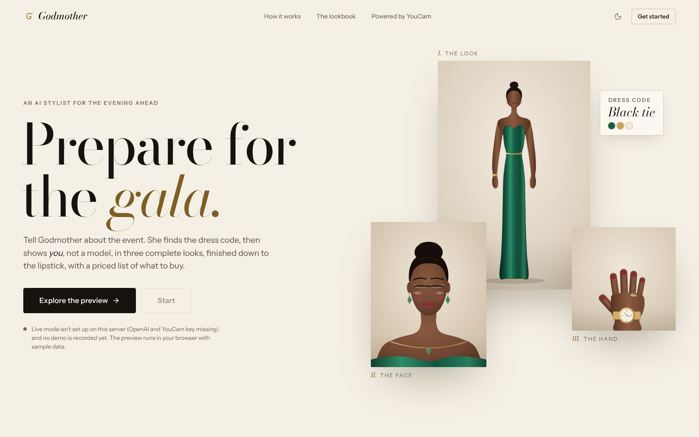
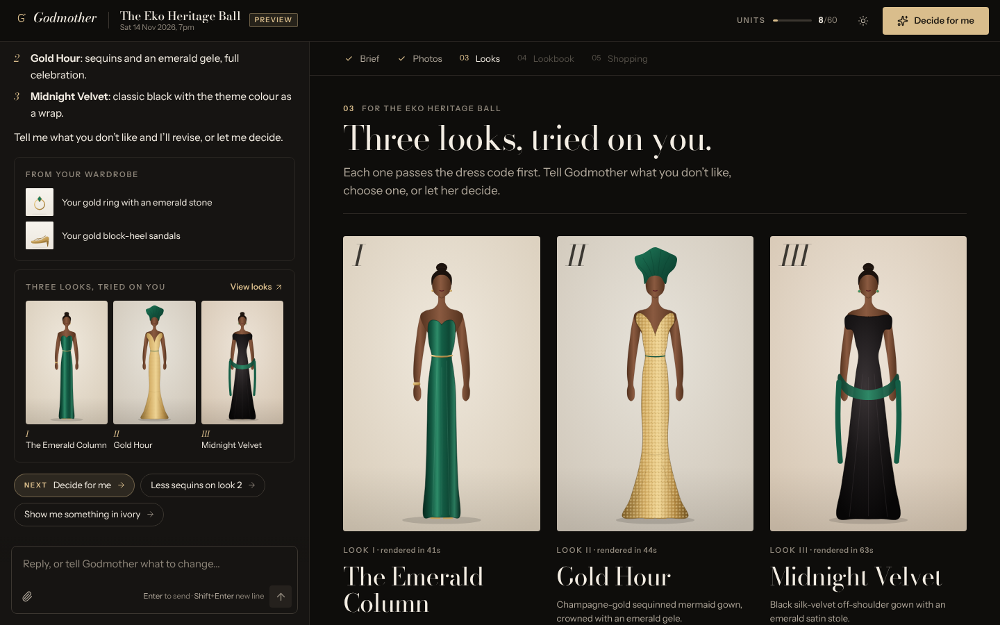
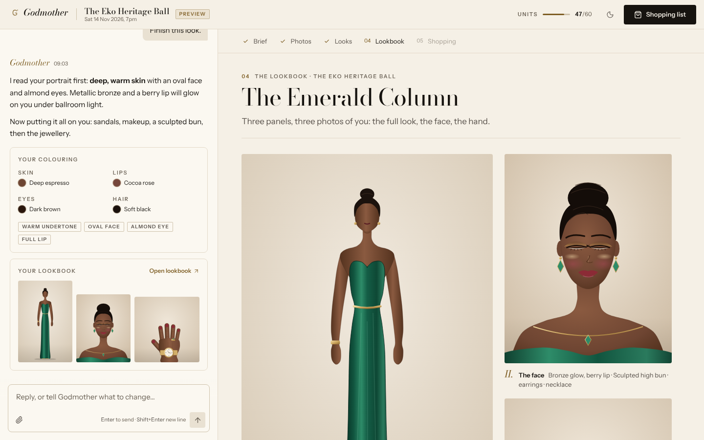
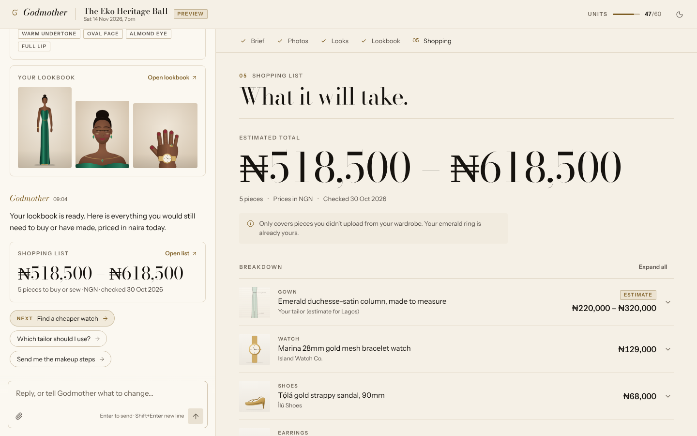

# Godmother

An AI stylist that gets you ready for one specific event and shows you, on your own photos, in three complete looks. For anyone with an occasion to dress for and no stylist.

**Try it:** https://godmother.cyberpunkinc.xyz (press Start, then continue as a guest: no sign-up, 50 YouCam units)

**Demo video:** [TODO: paste the YouTube link here before submitting]

**Project map:** [structure.md](structure.md) · **Every claim checked:** [docs/CLAIMS.md](docs/CLAIMS.md) · **Proof:** [evidence/](evidence/README.md)

## Built for the YouCam API Skin AI & eCommerce VTO Hackathon, eCommerce VTO track

The brief asks for beauty and fashion try-on brought together into one experience that changes how people shop ([rules and criteria](docs/HACKATHON.md)).

| Requirement | Where it's met |
|---|---|
| At least one YouCam API in a working prototype | 10 YouCam APIs, wrapped in [`youcam/features.ts`](app/src/lib/server/youcam/features.ts) |
| Beauty and fashion try-on in one flow | Clothes, shoes, makeup, hair and jewellery on one chosen look: [`tools/looks.ts`](app/src/lib/server/agent/tools/looks.ts), [`tools/finishing.ts`](app/src/lib/server/agent/tools/finishing.ts) |
| Clear consumer and retail value | Real shop listings tried on the user, then a priced list: [`tools/products.ts`](app/src/lib/server/agent/tools/products.ts), [`tools/shopping.ts`](app/src/lib/server/agent/tools/shopping.ts) |
| Agentic workflow | 15 tools and one turn loop: [`agent/loop.ts`](app/src/lib/server/agent/loop.ts), [`tools/index.ts`](app/src/lib/server/agent/tools/index.ts) |
| Public repository with a licence and run instructions | [LICENSE](LICENSE), [Judge check](#judge-check) |

## The problem

Try-on tools usually start from one product on one shop page. That answers "how does this shirt look on me?", not the question people actually have: "what do I wear to this wedding, and what do I need to buy?" Answering it means finding the dress code, building a whole outfit, and matching makeup, hair and jewellery to it, across several shops, before seeing any of it on yourself.

Godmother starts from the event and works toward the purchase.

**The one rule that drives it:** the event outranks taste. A stated dress code beats everything, then event colours and theme, then location and culture, then personal preference ([`agent/prompt.ts`](app/src/lib/server/agent/prompt.ts)).

## What it does

1. **Tell it about the event.** Give a name or link and the agent searches the web for the date, venue, dress code, theme and colours. Or describe it, or upload the invitation (photo or PDF).
2. **Set where you are.** Location shapes the suggestions and the shopping currency.
3. **Add up to three photos.** Full body, portrait and hand. Optionally, photos of clothes you own, which the agent catalogues and can use.
4. **Get three looks.** Each is a complete outfit tried on you. Pieces come from your wardrobe, from real shop listings (the product photo is what gets tried on), or from a design for a made-to-measure piece.
5. **Decide or revise.** Say what you dislike and only that look is re-rendered. Or say "decide for me" and the agent ranks the three and gives its reason.
6. **Finish the chosen look.** Face analysis, then shoes, makeup with DIY steps, hairstyle, earrings, necklace, watch and ring.
7. **Build the shopping list.** Everything you would have to buy or have made, priced in your currency. Pieces you own are left out.
8. **Film it (optional).** One button makes a 10-second video of the finished look.

Results open full screen with zoom and download. Signing in keeps your sessions on a History page.

## Why YouCam is load-bearing

Without YouCam there is nothing to see: the agent could describe an outfit, but could not show it on you. Every image of the user comes from these calls, all made from the server. A unit is charged only when a task succeeds.

| API | Endpoint | When it runs | Units |
|---|---|---|---|
| Clothes try-on | `POST /s2s/v2.0/task/cloth-v4` | Each garment, for all three looks | 2 per garment |
| Shoes | `cloth-v4` with `garment_category: "shoes"` | Chosen look only | 2 |
| Facial colour tones | `POST /s2s/v2.0/task/skin-tone-analysis` | Once per session, drives makeup | 20 |
| Face attributes | `POST /s2s/v2.0/task/face-attr-analysis` | Once per session, drives makeup and hair | 10 |
| Makeup try-on | `POST /s2s/v2.0/task/makeup-vto` | Chosen look only, from a validated plan | 1 |
| Hairstyle V2.1 | `POST /s2s/v2.1/task/hair-transfer` | Chosen look only, template picked by the agent | 2 |
| Jewellery 2D try-on | `POST /s2s/v2.0/task/2d-vto/{earring,necklace,ring,bracelet,watch}` | Portrait and hand photos, chosen look only | 1 each |
| Image Generator V2 | `POST /s2s/v2.0/task/text-to-image/youcam` | The made-to-measure path | 1 |
| Image to Video V2 | `POST /s2s/v2.0/task/image-to-video/youcam` | The optional film, at 480p | 10 |
| File API | `POST /s2s/v2.0/file` | Before tasks; each input is uploaded once | not in the price list |

A full run costs about 45 units, plus 2 for each top, dress or outer piece put on the portrait. Guests get 50 units once, which covers a typical run. The video needs 10 more, so it usually takes an account (60 units, with a fresh 60 claimable once a UTC day). Details of each call: [docs/API-NOTES.md](docs/API-NOTES.md).

## What works now

| Claim | Code | Proof |
|---|---|---|
| YouCam calls run for real: clothes, skin tone, face attributes, makeup, hair, jewellery, image generation | [`youcam/features.ts`](app/src/lib/server/youcam/features.ts) | [`evidence/live-run-ledger.md`](evidence/live-run-ledger.md) |
| Video from a finished look | [`agent/showcase-plan.ts`](app/src/lib/server/agent/showcase-plan.ts) | [`evidence/video-runs.md`](evidence/video-runs.md) |
| Spending can't pass the limit | [`youcam/ledger.ts`](app/src/lib/server/youcam/ledger.ts) | [`evidence/refusals.txt`](evidence/refusals.txt) |
| A bad makeup plan is refused before any unit is spent | [`youcam/makeup.ts`](app/src/lib/server/youcam/makeup.ts) | [`evidence/refusals.txt`](evidence/refusals.txt) |
| An interrupted turn resumes without paying twice | [`youcam/task-journal.ts`](app/src/lib/server/youcam/task-journal.ts) | Mocked tests, in [`evidence/verify-output.txt`](evidence/verify-output.txt) |
| It builds and all tests pass with no keys | [`app/package.json`](app/package.json) | [`evidence/verify-output.txt`](evidence/verify-output.txt) |

## Known limits

- **The video is AI-imagined.** Accessories can drift (a watch dial may change), and the camera path isn't reliable: the prompt asks for a face close-up and a full circle, and the model doesn't always do both. See [`evidence/video-runs.md`](evidence/video-runs.md).
- **Closing the tab during a video can lose it.** Keep the tab open or in the background until it finishes. A webhook-based fix is designed but not built.
- **Keyless previews are not live output.** The local preview and the screenshots below use illustrated figures from fixtures ([`client/mock.svelte.ts`](app/src/lib/client/mock.svelte.ts)), and the landing page uses AI-generated images of fictional people.
- **The committed run log is partial.** Shoes, ring, necklace and bracelet calls are built and tested against mocks, but aren't in [`evidence/live-run-ledger.md`](evidence/live-run-ledger.md).
- **Some API details are inferred from docs.** The switches are in [`youcam/tuning.ts`](app/src/lib/server/youcam/tuning.ts), and the notes are in [docs/API-NOTES.md](docs/API-NOTES.md).
- **One test is timing-sensitive.** The parallel looks test in `looks.test.ts` can fail when test files run at the same time on a busy machine, so `pnpm verify` runs them one file at a time.
- **One server is assumed.** Live turns are held in memory, and an interrupted one can be continued.

## Judge check

Needs Node.js 22.17 or newer and pnpm. No API keys, wallet or sign-up.

```bash
cd app
pnpm install
pnpm verify
```

That typechecks, runs the 193 tests (network calls mocked, no units spent) and builds. Real output: [`evidence/verify-output.txt`](evidence/verify-output.txt).

To see the product with no keys, run `pnpm dev`, open the URL it prints and choose **Explore the preview**. For real results on your own photos, use the [live site](https://godmother.cyberpunkinc.xyz).

## Screenshots

These come from the keyless preview, with illustrated figures. They are not real try-on output; the demo video shows that.









## Architecture

```
Browser: SvelteKit pages, static on Vercel (app/src/routes, app/src/lib/components)
  -> Cloudflare: domain, and the header that locks the API to this route
  -> API: same SvelteKit code as a Node server on Cloud Run (app/Dockerfile)
       agent/   15 tools and one turn loop     (app/src/lib/server/agent)
       llm/     provider-neutral model layer   (app/src/lib/server/llm)
       youcam/  files, tasks, unit ledger      (app/src/lib/server/youcam)
       store/   local disk first, cloud copy   (app/src/lib/server/store)
       units/   guest and account allowances   (app/src/lib/server/units)
       auth/    own accounts, Argon2id         (app/src/lib/server/auth)
  -> Anthropic: agent reasoning, web search, vision
  -> YouCam: the endpoints above
  -> Supabase Postgres, private Cloudinary images, Resend email: all optional
```

The browser never talks to Anthropic or YouCam, so keys stay on the server. Without the optional services the app still runs from local disk.

**Why it's built this way.** Units are the main constraint, so the server enforces it:

- **Outfits only for all three looks.** Shoes, makeup, hair and jewellery render only for the look you choose.
- **Face analysis once per session.** At 30 units it's the most expensive step, so the result is saved.
- **Units are reserved before any network call,** synchronously, so parallel looks can't overshoot.
- **Validate before paying.** Makeup plans are checked against YouCam's pattern labels first.
- **Never blindly retry a task create.** A create that timed out may still run and be charged. Task records let an interrupted request find its task instead.
- **Download results at once.** YouCam's result links expire after 2 hours.

Each YouCam feature frames the body differently, which is why there are three photos: full body for clothes and shoes, portrait for makeup, hair, earrings and necklace, and the hand for watch, ring and bracelet.

Details and tradeoffs: [docs/ARCHITECTURE.md](docs/ARCHITECTURE.md).

## Built during the hackathon vs pre-existing

- **Built during the hackathon (first commit 2026-10-30, see `git log`):** everything in this repository, including the app, the agent, the YouCam integration, the capability checks and the docs.
- **Pre-existing:** only open-source dependencies, listed in [`app/package.json`](app/package.json). The landing page images are AI-generated.

## Full setup

**Local, live mode.** Set `ANTHROPIC_API_KEY` and `YOUCAM_API_KEY`, then restart. [`app/.env.example`](app/.env.example) lists every variable, and the rest are optional.

```bash
cd app
cp .env.example .env
pnpm dev
```

**Production.** `pnpm build`, then `pnpm start`. The deployed setup (Vercel, Cloud Run, Cloudflare) and all variables are in [app/README.md](app/README.md).

**Live capability checks.** [`capability-checks/`](capability-checks/README.md) tested YouCam features against the live API before the app was built. Those calls spend units, and `pnpm check balance` is free.

## Security notes

Keys live only in server environment variables. Passwords use Argon2id, and email is confirmed by a code at sign-up. Images are private and served through an access check. The API only answers requests that came through Cloudflare. The app tells people how their photos are processed before they add one.

## Future improvements

- Webhooks so a video finishes and saves after the tab closes, with an optional email.
- A video model with keyframes, for a reliable camera path.

## Docs

- [structure.md](structure.md): project map, with links to every folder README
- [docs/CLAIMS.md](docs/CLAIMS.md): each claim mapped to code and proof
- [docs/SUBMISSION.md](docs/SUBMISSION.md): the Devpost text and checklist
- [docs/PRD.md](docs/PRD.md): product requirements and the unit budget
- [docs/HACKATHON.md](docs/HACKATHON.md): rules, judging criteria, unit prices
- [docs/ARCHITECTURE.md](docs/ARCHITECTURE.md): code layout, HTTP API, turn stream
- [docs/API-NOTES.md](docs/API-NOTES.md): YouCam endpoints, payloads and quirks found along the way
- [app/README.md](app/README.md): scripts, environment variables, deployment

## Licence

[MIT](LICENSE)
